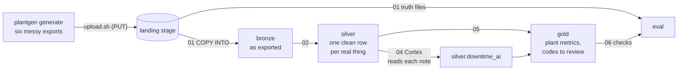

# Plant floor data pipeline on Snowflake

A bronze → silver → gold ("medallion") pipeline for a coating and slitting plant, built on
Snowflake, with an AI step: Snowflake Cortex reads operators' free-text downtime notes and
assigns each stop a reason code.

The plant is synthetic. `plantgen` simulates it and writes the files its systems would export,
including the mess real exports have. Nothing here comes from a real company. Because the
generator also writes the true answers, every number the pipeline produces can be checked.



## Results on Snowflake

Run on a trial account on 2026-11-07 and 08, following [`docs/RUNBOOK.md`](docs/RUNBOOK.md).
458 files loaded into bronze; silver and gold built; **all 82 checks of gold against the
generator's truth passed** ([screenshot](docs/screenshots/checks-82-of-82.png)). Every
silver, gold and eval table is saved in [`results/snowflake/`](results/snowflake/).

| Machine | Runs | Running h | Availability | Utilization | Scrap |
|---|---|---|---|---|---|
| C1 (coater, 60") | 212 | 1,136.06 | 76.4% | 74.3% | 1.63% |
| C2 (coater, 30") | 125 | 1,056.67 | 75.8% | 69.1% | 1.89% |
| S1 (slitter) | 178 | 736.24 | 78.5% | 48.1% | 0.42% |
| S2 (slitter) | 155 | 623.61 | 76.3% | 40.8% | 0.55% |

Availability is running time over running plus downtime; utilization is running time over
the 1,530 hours the plant was open. ([screenshot](docs/screenshots/machine-summary.png))

**Which AI reads the notes.** `03_ai_compare.sql` tried three Cortex methods on the same 200
stops: AI_CLASSIFY got 200 right, llama3.3-70b 195 and llama3.1-8b 177. `04_ai_reasons.sql`
then ran AI_CLASSIFY on all 2,364 stops (under a minute, about $12.70 in AI credits;
[more on cost](#trial-budget)):

| Reason from | Unplanned stops right | Planned stops right |
|---|---|---|
| HMI code, where the operator picked one | 638 of 717 (89.0%) | 740 of 740 (100%) |
| HMI code, all stops (blank or OTHER counts as wrong) | 638 of 1,549 (41.2%) | 740 of 815 (90.8%) |
| HMI code, else AI | 1,461 of 1,549 (94.3%) | 815 of 815 (100%) |
| AI on every stop | 1,531 of 1,549 (98.8%) | 814 of 815 (99.9%) |

([screenshot](docs/screenshots/reason-accuracy.png))

On every stop AI_CLASSIFY got 99.2% right, not the 100% the 200-stop sample showed. 12 of its
19 misses are one note, "adhesive viscosity off, waiting on lab", which the generator files
under ADHESIVE_SYSTEM and Cortex calls QC_HOLD; a person could argue either. The others are
typos and shorthand: "MP" (planned maintenance) read as MECHANICAL, "no croes" (cores) as
BLADE_CHANGE, "no po" (no operator) as MATERIAL_SHORTAGE.

**Codes worth a second look.** Gold doesn't overrule the operator. `gold.code_review` lists
the 86 stops where the operator's code and the AI disagree, longest first, 2,476 minutes in
all ([screenshot](docs/screenshots/code-review.png)). The AI was right on 76 of them, the
operator on 7. At the top: a 232-minute "Drive belt slipping" on S2, coded as planned
maintenance. Second is one the AI gets wrong: "MP", 102 minutes, which really was planned
maintenance.

The notes come from a fixed set of phrasings per reason, roughed up with abbreviations, typos
and shouting, and I wrote the reason descriptions knowing those phrasings. Real notes are
messier, so read these numbers as a best case.

## See it without Snowflake

The trial account goes away after 30 days. The whole run can be repeated locally, on any
machine with [uv](https://docs.astral.sh/uv/):

```bash
uv sync
uv run plantgen generate                              # the same files that went to Snowflake
uv run plantgen emulate --replay results/snowflake    # about 10 seconds
```

It runs the same SQL on [fakesnow](https://github.com/tekumara/fakesnow), a Snowflake
emulator built on DuckDB, with the answers Cortex gave on Snowflake in place of the AI calls.
Then it compares every table with the Snowflake export. It prints the checks, machine summary,
accuracy, model comparison and code review shown above, and ends:

```
same as Snowflake: 25 of 25 tables row for row (11,815 rows exported from the trial run)
```

The tests run that comparison too, so CI checks on every push that the local run still
matches Snowflake.

### What the emulator got wrong

The emulator passed all 82 checks before the Snowflake run. Snowflake still disagreed in
three places, and each is now handled:

1. **A FLATTEN on the left of a JOIN.** DuckDB ran `FROM summary s, LATERAL FLATTEN(...) e
   LEFT JOIN ...`; Snowflake refused it ("Lateral View cannot be on the left side of join").
   `06_check.sql` now flattens in a CTE and joins to that, and the emulator refuses the old
   shape before running anything (`SNOWFLAKE_RULES` in `src/plantgen/emulate.py`).
2. **Integer division.** Snowflake divides integers into a 6-place decimal; DuckDB into a
   float. Totals that land exactly on .x5 then round the other way, so three tables (two gold,
   one eval) were off by 0.1 in a few rows. Silver now casts minutes to `NUMBER(12, 6)`, Snowflake's own type
   for that division, so Snowflake's results didn't change (re-run and re-exported to check).
3. **fakesnow's sums.** fakesnow rewrites `SUM(x)` as `SUM(TRY_CAST(x AS DOUBLE))` so that it
   takes text the way Snowflake does. That undoes exact decimal sums: one daily total of
   exactly 322.35 minutes rounded to 322.3 instead of 322.4. Silver casts every column, so
   nothing sums text, and the emulator switches that rewrite off.

The account itself had surprises too (a lowercase username, key-pair logins matching the
login name, AI switched off on trials); those are in the runbook.

## The plant

- **Coater 1** (60" web) and **Coater 2** (30" web, older and slower) coat adhesive and
  laminate master rolls. **Slitter 1** and **Slitter 2** cut them to width.
- 12 products (polyester, polypropylene, polyimide and foil faces; acrylic, hot-melt and
  silicone adhesives). Runs 24/5, Monday 06:00 to Saturday 06:00, three shifts.
- Default run: 2026-08-03 to 2026-10-29, 352 work orders, 670 runs and 2,364 downtime events.
  Coater 1 is the bottleneck, about 1 order in 10 ships late, and jobs start about a day after
  the hand-built schedule says they will.
- 1,549 of the stops are unplanned, and more than half of those have no usable HMI reason code
  (OTHER or blank). The operator's note is the only record of what happened. That is the
  problem the AI step solves.

## Sources and their quirks

| Source | Format | What silver has to deal with |
|---|---|---|
| `erp_work_orders` | CSV, one row per change | latest `LAST_MOD` wins; cancellations; MM/DD/YYYY dates |
| `coater_runs` | CSV, ISO-8601 with UTC offset | a run crossing midnight appears open (blank end), then complete |
| `slitter_runs` | CSV from another vendor | meters, local MM/DD/YYYY HH:MM:SS, different headers |
| `hmi_downtime` | JSON lines | epoch milliseconds, nested operator, reason usually OTHER or missing |
| `qc_defects` | CSV | defect types spelled several ways |
| `schedule` | CSV | planned start/end per job (compare with actuals) |
| all of them | | equipment spelled several ways, sloppy badge ids, ~1% duplicate rows, ~3% of rows in the next day's file |

`data/reference/` has the lookup tables. `data/truth/` has the answers (true downtime reasons,
true run results, a summary); it goes into a separate `eval` schema, never into bronze.

## Generate the data

```bash
uv sync
uv run plantgen generate                 # writes data/raw, data/reference, data/truth
uv run plantgen generate --days 30 --seed 3 --out /tmp/plant
uv run plantgen generate --clean         # no quirks, for comparison
uv run pytest
```

## The emulator, other ways

The emulator can't read files from a stage, so it loads bronze itself (same tables, same
`_file` and `_row` columns); silver, gold and the checks run from `sql/` as written.

```bash
uv run plantgen emulate                  # no AI step: bronze, silver, gold, 82 checks
uv run plantgen emulate --classify http://127.0.0.1:11439 --sample 200   # AI step on a local model
```

`--classify` stands in for Cortex with any OpenAI-compatible server: same prompt file, and a
JSON schema that only allows the reason codes. Before the trial I ran it on all 2,364 stops
with Flash-Next, a local model (20 notes per request, about 90 minutes): HMI code else AI got
1,470 of 1,549 unplanned stops right (94.9%), and the AI alone 1,549 of 1,549 unplanned and 812
of 815 planned. That's close to Cortex, from a model on a desktop GPU.

## Snowflake run order

[`docs/RUNBOOK.md`](docs/RUNBOOK.md) has every command, what each step should show, the
expected row counts, and what to do when a step fails.

| File | What it does |
|---|---|
| `sql/00_setup.sql` | X-Small warehouse that suspends after 60 s idle, a resource monitor that stops it before the trial credits run out, a working role, the `plant` database with `bronze`, `silver`, `gold` and `eval` schemas, and the landing stage |
| `scripts/upload.sh` | PUTs `data/` and `prompts/` into the landing stage (Snowflake CLI) |
| `sql/01_bronze.sql` | Files land as-is: text columns, JSON as VARIANT, source file and load time on every row. Re-running COPY loads only new files |
| `sql/02_silver.sql` | One clean row per real thing: latest work-order version, runs merged from both vendors in feet and UTC, events flattened from JSON, aliases and spellings mapped, duplicates and late rows handled, running time = elapsed minus logged stops |
| `sql/03_ai_compare.sql` | Optional, once: AI_CLASSIFY, llama3.1-8b and llama3.3-70b on the same 200 stops, scored against the truth |
| `sql/04_ai_reasons.sql` | AI_CLASSIFY reads every stop's note that hasn't been classified yet and names a reason code; answers are kept, so re-runs only pay for new stops |
| `sql/05_gold.sql` | Machine summary (availability, utilization, scrap), downtime by reason before and after AI, codes worth a second look (where the operator's code and the AI disagree), scrap Pareto, on-time delivery by order and week, schedule adherence, daily output |
| `sql/06_check.sql` | Every gold number against `truth/summary.json`, data-quality counts, and the AI's accuracy per stop and per minute |
| `scripts/export.sh` | Saves every silver, gold and eval table to `results/snowflake/` as CSV |

`scripts/snowrun.sh sql/<file>.sql` runs one file and keeps its output in `logs/`.

## Trial budget

The trial lasts 30 days or $400 of credits, whichever ends first. The whole dataset is about
2 MB, so the warehouse barely runs. Self-service trials have AI functions switched off until a
credit card is on the account; adding one doesn't upgrade or end the trial, and Cortex use
still comes out of the free credits.

Cortex is billed in AI credits per million tokens
([Service Consumption Table](https://www.snowflake.com/legal-files/CreditConsumptionTable.pdf),
effective 2026-10-29, Table 6(a)); one AI credit is $2.00 with cross-region routing, $2.20
without ([pricing](https://docs.snowflake.com/en/user-guide/snowflake-cortex/pricing)). What
the run used, from ACCOUNT_USAGE (saved in [`results/cost/`](results/cost/); the queries are at
the bottom of `03_ai_compare.sql`):

| Function | Model | Stops | Tokens | Per stop | AI credits | At $2.00 |
|---|---|---|---|---|---|---|
| AI_CLASSIFY | (Snowflake picks) | 2,564 (200 in 03, 2,364 in 04) | 4,257,461 | ~1,660 | 6.897 | $13.79 |
| AI_COMPLETE | llama3.3-70b | 200 (03) | 79,876 | ~400 | 0.035 | $0.07 |
| AI_COMPLETE | llama3.1-8b | 200 (03) | 79,449 | ~400 | 0.010 | $0.02 |

The AI_COMPLETE rows also hold the one-call smoke test. The warehouse used another 0.393
credits over the two days, so the whole run came to about $15 of the $400.

**My estimate was a quarter of that.** I had put it at about 1.8 AI credits, from roughly 420
tokens per stop: the note, the 13 labels and their descriptions. The rate was right (6.897
credits for 4.26M tokens is 1.62 per million); the token count wasn't. AI_CLASSIFY wraps a
prompt of its own around every call, which the
[docs](https://docs.snowflake.com/en/sql-reference/functions/ai_classify) mention without
saying how long it is. On this run it was most of what was billed.

So per stop, AI_CLASSIFY cost about 16 times as much as llama3.3-70b and 50 times as much as
llama3.1-8b. On all 2,364 stops that is about $12.70, against $0.80 for llama3.3-70b (2.5
points lower on the sample) and $0.25 for llama3.1-8b (11.5 points lower). At this size the
difference doesn't matter; at a plant's full volume, or with years of history to backfill, it
is the first number to weigh against those 2.5 points.

## Status

- [x] Generator and tests
- [x] Setup, bronze, silver, gold, AI and check SQL written
- [x] Silver, gold and checks pass on the local emulator, messy and clean data
- [x] AI step tried locally (Flash-Next, a local model)
- [x] CI: tests, lint and a Snowflake-dialect parse of every SQL file on each push
- [x] Trial runbook
- [x] Trial account started (2026-11-07)
- [x] Bronze loaded (458 files)
- [x] Silver, gold and checks on Snowflake (82 of 82)
- [x] Cortex comparison and classification (AI_CLASSIFY on 2,364 stops)
- [x] Results and screenshots in the repo
- [x] Emulator reproduces the Snowflake run, table for table
- [x] Actual Cortex cost from ACCOUNT_USAGE (6.94 AI credits, about $14)
